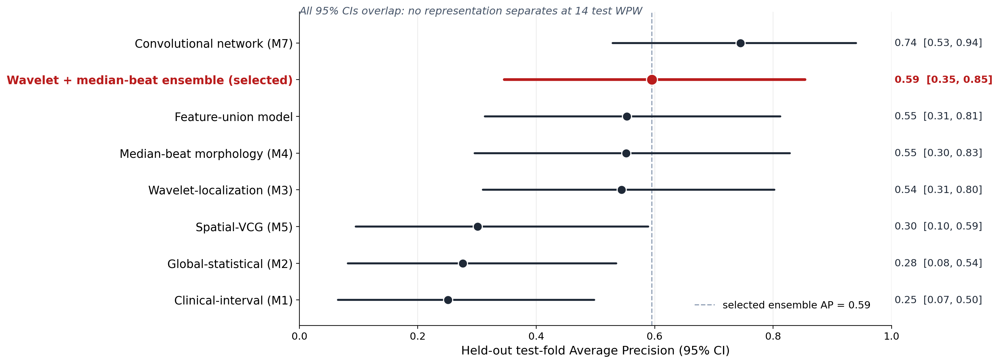
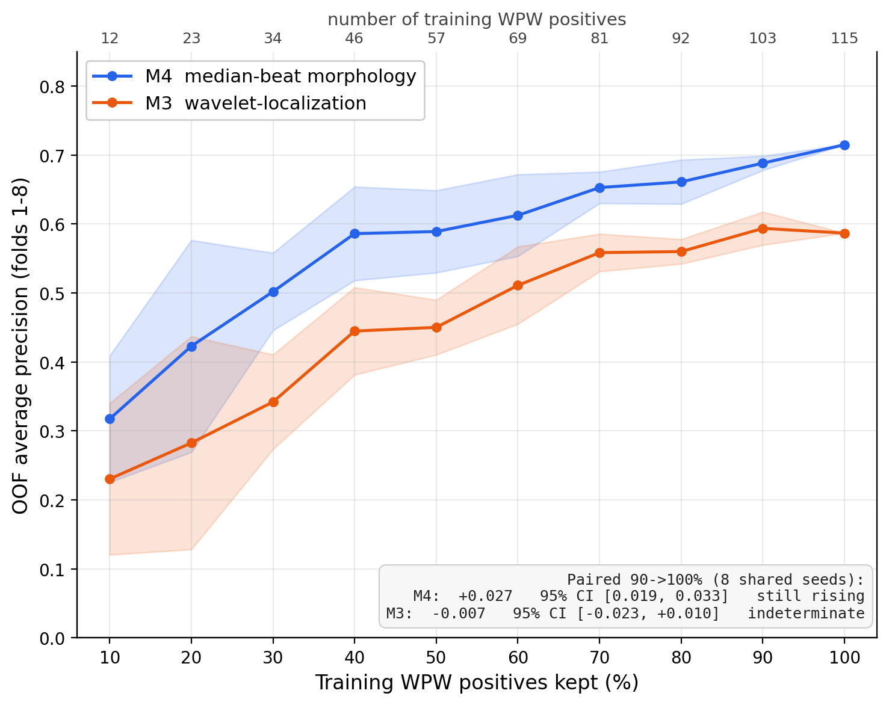

# WPW detection from the 12-lead ECG

Code, frozen models and decision log for detecting Wolff-Parkinson-White syndrome (WPW) on standard 12-lead ECGs, where WPW appears in 142 of 66,951 recordings (0.21%, about 1 in 471).

**Paper:** [arXiv:2608.14633](https://arxiv.org/abs/2608.14633) (preprint, not peer-reviewed) · **Demo:** [wpwdetector.com/demo](https://wpwdetector.com/demo) · **Project site:** [wpwdetector.com](https://wpwdetector.com)

> Research code. Not a medical device and not a diagnosis.

## Result

The deployed detector is an equal-weight rank vote of two models (M3 wavelet + M4 median beat). Its composition, weights and threshold were frozen before the held-out fold (fold 10: 6,713 ECGs, 14 WPW) was scored, once.

| Held-out fold 10 | Value |
|---|---|
| ROC AUC | 0.950 (95% CI 0.89 to 1.00) |
| Average precision | 0.595 (95% CI 0.35 to 0.85) |
| At the frozen threshold | 11 flagged: 8 WPW, 3 false alarms, 6 WPW missed |
| Recall / precision | 0.571 / 0.727 |
| Specificity | 99.96% |



With 14 positives in the test fold, every interval overlaps: the held-out data cannot rank these models against each other.

## Seven representations, one protocol

Each model reads the same split and the same evaluation code. Out-of-fold (OOF) numbers come from folds 1 to 8 (115 WPW).

| ID | Representation | OOF AP | Held-out AP [95% CI] | Held-out AUC |
|---|---|:---:|:---:|:---:|
| M1 | QRS-onset morphology (NeuroKit2 delineation) | 0.198 | 0.251 [0.065, 0.498] | 0.941 |
| M2 | Global per-lead statistics and spectra | 0.299 | 0.276 [0.082, 0.535] | 0.897 |
| M3 | Wavelet time-frequency at QRS onset | 0.619 | 0.544 [0.310, 0.802] | 0.957 |
| M4 | Median-beat morphology | 0.718 | 0.552 [0.296, 0.828] | 0.903 |
| M5 | Spatial vectorcardiogram | 0.429 | 0.301 [0.095, 0.589] | 0.913 |
| M6 | Marquette 12SL on-machine measurements (commercial reference, PTB-XL only) | 0.583 | 0.442 (7 WPW) | n/a |
| M7 | 1D residual CNN, about 63,500 parameters | 0.651 | 0.745 [0.529, 0.940] | 0.978 |
| **Deployed** | **M3 + M4 rank vote** | **0.717** | **0.595 [0.346, 0.854]** | **0.950** |

M7 has the highest held-out point estimate. It was not promoted after the fact, because the deployed system was frozen before fold 10 was opened and the intervals overlap.

## What did not raise the ceiling

Five attempts to beat the two-model vote, as paired OOF differences in average precision:

| Attempt | Difference [95% CI] |
|---|---|
| Add the spatial VCG detector (M5) | −0.049 [−0.080, −0.021] |
| One model on the union of the best M1 to M5 features | +0.009 [−0.026, +0.041] |
| Same union plus classical intervals | +0.023 [−0.009, +0.055] |
| CNN from scratch (M7) vs wavelet (M3) | +0.032 [−0.022, +0.084] |
| Self-supervised pretraining vs scratch | +0.014 per seed (about 1 SD), below the pre-registered 3 SD gate |

Meanwhile, the learning curve for M4 was still rising at the full 115 training positives (90% to 100%: +0.027, 95% CI [0.019, 0.033]). Feature selection was re-run at each size, so the curve carries no selection leak.



## What the errors show

On the development folds the vote made 80 detections, 25 false alarms and 35 misses.

- **Missed cases have narrower QRS complexes.** The acquisition device's own measurement (Marquette 12SL) gives 103 ms for misses vs 140 ms for detections (p = 2.2 × 10⁻⁶, Holm-adjusted 2.7 × 10⁻⁵). Of 12 tests in the error-analysis family, this is the only one that survives correction ([`reports/metrics/error_analysis_holm_family_v2.json`](reports/metrics/error_analysis_holm_family_v2.json)).
- **The direction depends on the delineator.** A signal proxy agrees with the device (correlation 0.58) but returns impossible values below 60 ms on 9 of 57 cases; NeuroKit2 reverses the sign (correlation −0.22). See `qrs_three_delineators.py`.
- **Part of the label problem sits in the negative class.** 6 of the 25 false alarms are recordings the corpus itself codes as pre-excited, under a code the WPW label definition did not include. See `fp_miss_code_audit.py`.
- **Uncertain positive labels are not enriched among misses** (OR 0.41, p = 0.27).
- **Comorbidity masking** (5 of 14 misses vs 2 of 43 detections) does not survive correction (Holm-adjusted p = 0.073).

## Output: a rank, not a probability

Each model's raw score is converted to a percentile within a frozen reference distribution of training scores, the two percentiles are averaged, and one frozen threshold is applied. The demo shows this as a 1 to 100 suspicion level. Raw scores do not transfer between hospitals: M4's 99th-percentile score is 0.0336 on PTB-XL and 0.0125 on Chapman-Shaoxing-Ningbo, a factor of 2.7.

**External specificity check (Georgia G12EC, never used in development):** 10,344 ECGs scored with no failures. 9 (0.087%) reached the two highest levels, all non-WPW. The corpus has only two WPW labels, so sensitivity cannot be estimated there.

## Protocol

- Two public corpora pooled: PTB-XL (70 WPW / 21,799) and Chapman-Shaoxing-Ningbo (72 WPW / 45,152).
- Ten folds: 1 to 8 for development (115 WPW), 9 for validation (13), 10 held out (14).
- PTB-XL is split by patient (18,869 patients). Chapman-Shaoxing-Ningbo has no patient identifier, so each recording counts as one patient; a near-duplicate search over the 142 WPW recordings is in `dedup_wpw.py`.
- 0.5 to 40 Hz fourth-order zero-phase Butterworth filter, fixed before modelling.
- Label-permutation control: with shuffled labels, every feature model falls to AP 0.002 to 0.003 (the prevalence).
- Nested re-selection on the two feature-union models costs 0.11 to 0.13 AP, so OOF numbers here are upper estimates. The held-out fold is unaffected.
- Every design decision, with the rejected alternative, is logged in [`JOURNAL.md`](JOURNAL.md).

## Limitations

- 14 held-out positives give wide intervals.
- Two training corpora; no third corpus to measure sensitivity.
- No cardiologist adjudicated the labels; 44 of 57 PTB-XL development positives are non-validated in the source data.
- The CNN is about two orders of magnitude smaller than benchmark ECG architectures (single laptop, CPU only).
- The permutation control used five shuffles.

## Repository

```
config.py           repo-relative paths (override raw data location with WPW_RAW_DATA)
requirements.txt    pinned dependencies
JOURNAL.md          decision log
src/                signal loading, evaluation, feature extraction, SHAP
notebooks/          01 to 13: setup, EDA, each detector, error analysis, ensemble, held-out evaluation
models/             frozen models, OOF and fold 9/10 scores, ensemble reference distribution
data/               light processed artifacts; data/README.md explains how to download the raw ECGs
reports/            figures/ and metrics/ (one JSON per model)
paper/              LaTeX source of the preprint
*.py (root)         standalone analyses from the paper: learning curve, delineator comparison,
                    12SL column audit, false-alarm code audit, near-duplicate search,
                    age confound, comorbidity profile, figure scripts
```

Raw ECGs are not included; they come from PhysioNet (see [`data/README.md`](data/README.md)). The multi-gigabyte feature matrices are regenerated by the notebooks. The frozen models, scores and metric files are committed, so every reported number can be checked without retraining.

## Citation

```bibtex
@misc{altman2026wpw,
  title         = {Wolff-Parkinson-White Detection at 471:1 Class Imbalance: A Leakage-Controlled Study of the Data Bottleneck},
  author        = {Altman, Nathael},
  year          = {2026},
  eprint        = {2608.14633},
  archivePrefix = {arXiv},
  primaryClass  = {eess.SP}
}
```

## Data and attribution

- **PTB-XL**, CC BY 4.0: Wagner P., Strodthoff N., Bousseljot R.-D., et al. PTB-XL, a large publicly available electrocardiography dataset. *Scientific Data* 7, 154 (2020).
- **Chapman-Shaoxing-Ningbo**, via PhysioNet: Zheng J., et al. A 12-lead electrocardiogram database for arrhythmia research (Chapman University and Shaoxing People's Hospital), and its Ningbo extension. [doi:10.13026/wgex-er52](https://doi.org/10.13026/wgex-er52)
- **PhysioNet**: Goldberger A.L., et al. PhysioBank, PhysioToolkit, and PhysioNet. *Circulation* 101(23):e215-e220 (2000).
- **Marquette 12SL** is a proprietary commercial algorithm, used only as a comparison baseline (M6) and not redistributed.

## License

MIT (see [`LICENSE`](LICENSE)).
